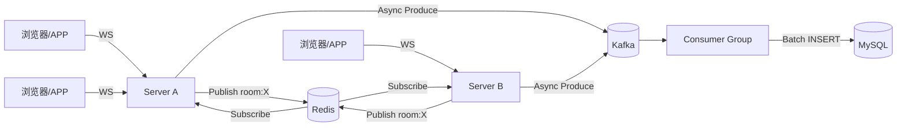

# 01 · 架构与四条链路

整个系统只有四条链路。把这四条链路在脑子里跑通，代码就通了 80%。

| 链路 | 触发 | 经过 | 关键代码 |
|------|------|------|----------|
| ① 连接 | 客户端 `GET /ws` | Upgrade → NewClient → Register → 建房间订阅 | `api/chat_handler.go:43`、`ws/manager.go:175` |
| ② 上行 | 用户发弹幕 | ReadPump → Dispatch → Broadcast → Kafka + Redis Publish | `ws/client.go:42`、`ws/manager.go:236` |
| ③ 下行 | Redis 推来消息 | 订阅协程 → 本地切片 → 100 worker → Send chan → WritePump | `ws/manager.go:367`、`ws/manager.go:400` |
| ④ 落盘 | Kafka 有消息 | ConsumerGroup → msgChan → dbWorker 攒批 → INSERT | `consumer/handler.go:297`、`consumer/handler.go:343` |

---

## ① 连接建立：一个房间一个订阅协程

```go
// api/chat_handler.go
uid, _ := strconv.ParseUint(c.Query("uid"), 10, 64)   // 身份从 query 来（无鉴权，见 05）
conn, _ := upgrader.Upgrade(c.Writer, c.Request, nil)  // HTTP 升级为 WS
client := ws.NewClient(uid, name, room, conn)
h.manager.Register <- client       // 交给 Manager 注册（串行处理，避免锁竞争）
go client.WritePump()              // 写协程
client.ReadPump(h.manager)         // 读循环，阻塞在当前 handler 的 goroutine 里
```

`handleRegister` 做两件事，都在写锁内完成：

```go
if _, ok := m.Rooms[client.RoomID]; !ok {
    m.Rooms[client.RoomID] = make(map[*Client]struct{})
    ctx, cancel := context.WithCancel(context.Background())
    m.cancelSub[client.RoomID] = cancel
    go m.subscribeToRoom(ctx, client.RoomID)   // ← 本机第一个进这个房间的人才启动订阅
}
m.Rooms[client.RoomID][client] = struct{}{}
```

**设计点**：Redis 订阅是「按房间、按实例」的，不是按连接。同一台机器上 5 万人看同一个直播间，只有一个 Redis 订阅协程，收到一条消息后扇出给 5 万人。这是整个系统能扛住广播风暴的根本原因。

**生命周期**：最后一个客户端离开时 `cancel()`，订阅协程退出，`delete(m.Rooms, roomID)`。空房间不会留下 goroutine 和 Redis 连接。

---

## ② 上行：只写 Kafka + 只 Publish，绝不在本地扇出

```
ReadPump ──► json.Unmarshal(WsPacket) ──► Dispatch(type, data)
                                              │
                                    TypeDanmaku(101)
                                              ▼
                    router.go: 补全 RoomID / UserID / SendTime（服务端权威）
                                              ▼
                              m.Broadcast <- &packet
                                              ▼
                    Manager 主循环 handleBroadcast
                              ┌───────────────┴───────────────┐
                              ▼                               ▼
                   Kafka PushToInput              Redis PublishToRoom
                   （持久化，异步）                  （跨机分发）
```

`handleBroadcast` 里这段注释是精髓：

```go
case model.TypeDanmaku:
    m.processDanmaku(packet.RoomID, payload)
// 注意：这里不调用 broadcastToLocalClients。
// 因为订阅协程也会收到这条 Redis 消息并触发本地扇出，
// 如果这里再扇出一次，本机用户会看到重复弹幕。
```

也就是说，**发送者本机也走「Redis 回环」这条路**。代价是多一次 Redis 往返（本机 Publish → 本机 Subscribe），收益是广播路径只有一条，代码没有分叉、不会重复。这是一个典型的「用一点点延迟换实现简洁性」的取舍。

`processDanmaku` 只有两行：

```go
infra.PushToInput(m.KafkaProducer, infra.DanmakuSaveTopic, data)  // 存
infra.PublishToRoom(m.RedisClient, roomID, data)                  // 播
```

---

## ③ 下行：切片 + 100 worker + 每条连接 4096 缓冲

```go
func (m *Manager) broadcastToLocalClients(roomID string, payload []byte) {
    m.mu.RLock()
    clients, ok := m.Rooms[roomID]
    if !ok { m.mu.RUnlock(); return }

    targetClients := m.clientPool.Get().([]*Client)  // 从池里拿切片，不 make
    targetClients = targetClients[:0]
    for c := range clients { targetClients = append(targetClients, c) }
    m.mu.RUnlock()                                    // ← 先解锁，再发送

    job := &BroadcastJob{Clients: targetClients, Payload: payload}
    select {
    case m.broadcastJobChan <- job:   // 1000 缓冲
    default:
        m.clientPool.Put(targetClients)  // 队列满：丢弃 + 立即还池，防泄漏
    }
}
```

三个细节值得抄：

1. **锁只保护「取快照」**，真正的发送在锁外做。否则一个大房间广播时会长时间持有 RLock，注册/注销全部被堵。
2. **切片来自 sync.Pool**，大房间一次广播要拷贝 5 万个指针，频繁 `make` 会把 GC 打爆。
3. **投递是非阻塞的**。worker 跟不上就丢整条消息并还池，绝不阻塞 Redis 订阅协程（否则 Redis 客户端缓冲区会堆积）。

worker 侧：

```go
for job := range m.broadcastJobChan {
    for _, client := range job.Clients { m.safeSend(client, job.Payload) }
    m.clientPool.Put(job.Clients)   // 谁用谁还
}

func (m *Manager) safeSend(client *Client, payload []byte) {
    select {
    case client.Send <- payload:       // 容量 4096
    default:                            // 慢客户端：丢这条，不阻塞
    }
}
```

**100 个 worker 是「按 job 分片」，不是「按连接分片」**：一条弹幕是一个 job，被一个 worker 完整消费。所以同一条消息对某个客户端的顺序是有保证的，但不同消息之间可能乱序（job 被不同 worker 并发处理）。弹幕场景能接受。

客户端侧两条泵：

| 协程 | 职责 | 退出条件 |
|------|------|----------|
| `ReadPump` | 读 WS → 解析 → Dispatch | 读错误 → 发 Unregister |
| `WritePump` | `<-c.Send` → `WriteMessage` | `<-c.done` |

```go
func (c *Client) Close() {
    c.once.Do(func() {
        close(c.done)      // 通知 WritePump 退出
        c.Socket.Close()
        // 刻意不 close(c.Send)：worker 可能正在往这里发，close 会 panic
    })
}
```

> 这是 Go 并发里最经典的坑：**永远不要由发送方 close channel**。作者选择用 `done` + `sync.Once` 做退出信号，`Send` 永不关闭，从根上消除了 `send on closed channel`。

---

## ④ 统计：心跳式在线人数 + 本地聚合点赞

每 3 秒一次，且是 `go m.broadcastStats()` 异步执行——因为里面有 Redis I/O，同步跑会堵住 `Register/Unregister` 的 select 分支（队头阻塞）。

```go
// 1. 换出本地点赞（交换 map 而不是持锁累加，缩短临界区）
m.likesMu.Lock()
currentBatchLikes := m.localLikes
m.localLikes = make(map[string]uint64)
m.likesMu.Unlock()

// 2. RLock 快照每个房间的本地人数
m.mu.RLock()
for roomID, clients := range m.Rooms { localStats[roomID] = len(clients) }
m.mu.RUnlock()

// 3. 逐房间上报 + 聚合 + 本地广播
for roomID, count := range localStats {
    infra.UpdateServerOnline(rdb, roomID, m.ServerID, count, 7*time.Second) // SET count EX 7 + SADD servers
    infra.IncrRoomLikes(rdb, roomID, delta)                                  // INCRBY 批量
    totalOnline := infra.GetTotalOnline(rdb, roomID)                         // SMembers + MGet 求和
    totalLikes  := infra.GetRoomLikes(rdb, roomID)
    m.broadcastToLocalClients(roomID, statsPayload)   // 只广播本机，不走 Redis
}
```

Redis key 设计：

| Key | 类型 | 作用 | TTL |
|-----|------|------|-----|
| `room:{id}:pubsub` | channel | 弹幕广播 | — |
| `room:{id}:likes` | string | 点赞总数 | 永久 |
| `room:{id}:online:{serverID}` | string | 本机在线数 | **7s（心跳）** |
| `room:{id}:servers` | set | 有哪些 server 在报数 | 永久（惰性清理） |

**为什么用心跳而不是 INCR/DECR？** 连接增减时 INCR/DECR 更实时，但进程被 kill -9 时 DECR 永远不会执行，在线人数只增不减，越漂越大。心跳方案下，server 挂了最多 7 秒后 key 自动过期，`GetTotalOnline` 读到 nil 时顺手 `SRem` 清掉注册表。**用「周期性覆盖写」换「崩溃自愈」**，这笔买卖很划算。

---

## ⑤ 落盘：channel 解耦 + 攒批 + 背压

```go
// ConsumeClaim：只做解析和入队，几乎不耗时
danmaku, err := h.parseMessage(msg)
select {
case h.msgChan <- danmaku:     // 容量 2000，满了就阻塞 → 自然背压，Kafka 消费变慢
    session.MarkMessage(msg, "")   // ← 入队即 commit（at-most-once，见 05）
case <-ctx.Done():
    return nil
}

// dbWorker：独立协程攒批
for {
    select {
    case msg, ok := <-h.msgChan:
        buffer = append(buffer, msg)
        if len(buffer) >= batchSize { flush(); buffer = buffer[:0] }
    case <-ticker.C:            // 2s 兜底，防止低峰期数据一直躺在内存
        if len(buffer) > 0 { flush(); buffer = buffer[:0] }
    case <-ctx.Done():
        flush(context.Background())   // 用 Background 保证最后一次刷盘不被取消
        return
    }
}
```

`Cleanup` 的顺序也很讲究：

```go
close(h.msgChan)   // 通知 worker 没有新数据了
h.wg.Wait()        // 等 worker 把剩余 buffer 刷完再返回，否则 rebalance 会丢数据
```

---

## 整体部署形态



扩容方式很直接：**Server 无状态**，直接加机器；新实例启动后自己订阅需要的房间，Redis 负责把消息扩散给所有实例。真正的瓶颈会先出现在 Redis 单实例带宽和 MySQL 写入上，而不是 Go 服务本身。

---

下一篇：[02 性能设计的 12 个手法](02-performance-tricks.md)
