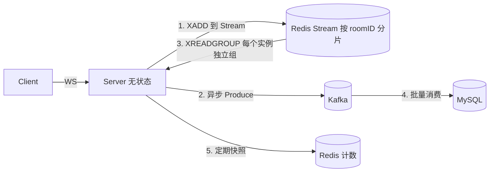

# 05 · 设计边界与改进清单

学一个项目，只看它「做对了什么」只能学到一半。这一篇专门挑问题——**能指出问题，才算真的读懂了**。

按「会不会在线上出事」排序。

---

## 🔴 P0：会导致数据丢失或服务卡死

### 1. Redis Pub/Sub 是「尽力而为」，订阅断线期间的弹幕永久丢失

**代码**：`internal/ws/manager.go:367` `subscribeToRoom`

Redis Pub/Sub 没有持久化、没有 ACK、没有消费位点。一旦出现：

- 本机 Redis 连接抖动，`pubsub.Channel()` 断开重连（go-redis 会自动重连，但**重连期间的消息不会补发**）
- 房间在 0 人时取消订阅，第 1 个人进来重新订阅，中间的空窗期消息全丢

结果：用户看到「弹幕缺了一块」，而且没有任何日志。

**改法**：换成 Redis Stream（`XADD` / `XREADGROUP`），每个 server 用独立 consumer group 消费，断线后从 last delivered ID 续上；或者干脆让每个 server 直接消费 Kafka（Kafka 本来就已经存了一份），Redis 只做「加速通知」：

```go
// 通知型：Pub/Sub 只发 roomID，不带消息体
Publish("room:notify", roomID)
// 拉取型：收到通知后从 Stream/Kafka 按 roomID 拉最近 N 条
```

代价是多一次拉取 RTT，收益是**不丢消息**。B 站这类系统实际用的是「推拉结合」。

---

### 2. 消费端实际是 at-most-once，不是注释里说的 at-least-once

**代码**：`internal/consumer/handler.go:324`

```go
select {
case h.msgChan <- danmaku:
    session.MarkMessage(msg, "")   // ← 入队即标记已消费
case <-ctx.Done():
}
```

MarkMessage 之后 Sarama 每 1 秒自动提交 offset。此时数据还在 `msgChan`(2000) 或 `buffer`(batchSize) 里，**没有落库**。进程被 kill -9，最多丢 `2000 + batchSize` 条，且 offset 已经提交，重启也补不回来。

文件顶部的注释写得很诚实：「DB is at-most-once」——但 README 里没提。

**改法**：把「mark」推迟到 flush 成功之后。Sarama 支持手动提交：

```go
config.Consumer.Offsets.AutoCommit.Enable = false
// dbWorker 刷盘成功后：
session.Commit()   // 注意：Commit 是 session 级的，会把当前所有已 mark 的 offset 提交
```

但这样会让「批量刷盘」和「offset 提交」耦合，重平衡时更容易重复消费。**正确做法**是接受 at-least-once（可能重复），用 `(room_id, user_id, send_time)` 做唯一索引 + `INSERT IGNORE` 实现幂等。弹幕重复一条，比丢一条好。

---

### 3. Kafka 写入是阻塞调用，Kafka 挂了会卡住整个 Manager 主循环

**代码**：`internal/infra/kafka.go:116`

```go
func PushToInput(producer sarama.AsyncProducer, topic string, payload []byte) {
    msg := &sarama.ProducerMessage{...}
    producer.Input() <- msg     // ← 阻塞写
    // 下面这段「非阻塞 + 丢弃」被注释掉了
    // select {
    // case producer.Input() <- msg:
    // default: 丢弃
    // }
}
```

调用链：`Manager.Start` 主循环 → `handleBroadcast` → `processDanmaku` → `PushToInput`。

Sarama 的 `Input()` 有 16384 缓冲，正常情况下不会阻塞。但 **Kafka 不可用 + 缓冲打满**时，这里会阻塞，于是 `handleBroadcast` 阻塞，于是 `Register`/`Unregister` 全部排队——**新用户进不来，退出的人注销不掉，房间表状态错乱**。

而且注释里那段代码注释掉后，`logger` 和 `zap` 的 import 还在，说明是后期改的，属于「压测时没触发、线上一定会触发」的典型。

**改法**：恢复非阻塞版本，或者更好——把 Kafka 写入放到独立 goroutine + 有界队列：

```go
// 方案 A：快速失败
select {
case producer.Input() <- msg:
default:
    metrics.Incr("kafka_dropped")
}
```

**注意**：广播链路（Redis Publish）不能受持久化影响，这两件事必须解耦。

---

### 4. 点赞数在进程崩溃时丢失，且 INCRBY 失败无重试

**代码**：`internal/ws/router.go:73` + `manager.go:300`

```go
m.likesMu.Lock(); m.localLikes[c.RoomID] += likes.Count; m.likesMu.Unlock()
// 3 秒后：
currentBatchLikes := m.localLikes
m.localLikes = make(map[string]uint64)   // ← 已经换出，内存里没有了
go infra.IncrRoomLikes(...)              // ← 异步，失败只打日志
```

两个窗口：换出 map 后到 INCRBY 成功之间崩溃 → 这批点赞永久丢失；Redis 超时 → 也只打日志，不重试。

**改法**：先 INCRBY 成功再清 map；失败则把 delta 合并回新 map（用 `sync.Map` 或加锁合并），下个周期重试。

---

## 🟠 P1：资源泄漏与错误行为

### 5. sync.Pool 归还切片时没清空元素 → 内存泄漏

**代码**：`internal/ws/manager.go:151`

```go
for _, client := range job.Clients { m.safeSend(client, job.Payload) }
m.clientPool.Put(job.Clients)     // ← 元素还在！切片底层数组持有 *Client 强引用
```

池里的 `[]*Client` 长度虽然会在下次 `[:0]` 时归零，**但底层数组里的指针仍然指向旧 Client**，GC 认为这些 Client 可达，无法回收。长期运行后池里会积累大量已断开的连接对象。

Go 1.20+ 的 `sync.Pool` 在 GC 时会清空整个池，所以泄漏是「两次 GC 之间」的，不会无限增长，但在 6 万连接场景下依然是可观的常驻内存。

**改法**：

```go
for i := range job.Clients { job.Clients[i] = nil }   // 清零
job.Clients = job.Clients[:0]
m.clientPool.Put(job.Clients)
```

`sync.Pool` 的官方文档明确要求：**Put 之前要清空引用**。

---

### 6. `room:{id}:servers` 这个 Set 只增不减（惰性清理不彻底）

**代码**：`internal/infra/redis.go:177`

```go
if val == nil {
    go rdb.SRem(ctx, registryKey, serverIDs[i])   // 只有读到 nil 才清
}
```

问题在于：只有在**该房间还有人、且正在做统计**时才会读到 nil。房间彻底冷掉之后，Set 里残留的 serverID 永远没人清。长期运行会积累大量垃圾 Set。

**改法**：给 registry Set 本身加一个较长的 TTL（比如 1 小时），每次 `SADD` 时 `EXPIRE` 续期。

---

### 7. 统计逻辑的 Redis 往返随「房间数」线性放大

每个房间每 3 秒：`Pipeline(SET + SADD)` + `SMembers` + `MGet` + `Get` = **4 次网络往返**。

1000 个活跃房间 → 每秒 1333 次 RTT。这个开销不小，而且完全可以用 **一个大 Pipeline 把所有房间的操作合并**：

```go
pipe := rdb.Pipeline()
for roomID, count := range localStats {
    pipe.Set(ctx, countKey(roomID, serverID), count, ttl)
    pipe.SAdd(ctx, serversKey(roomID), serverID)
    pipe.SMembers(ctx, serversKey(roomID))
    pipe.Get(ctx, likesKey(roomID))
}
pipe.Exec(ctx)
```

一次 RTT 搞定全部房间，代价是「聚合总和」要延迟到下一次周期（或者本地用上一轮的 server 列表），可以接受。

---

### 8. 慢客户端只丢消息，不踢人

`safeSend` 的 `default` 分支只打 Warn 日志。一个网络极差的客户端会永远占着连接，每秒被丢上千条消息，日志被打爆。

**改法**：给 Client 加 `dropCount`，连续丢弃超过阈值（比如 1000 条 / 10 秒）就 `Close()`，让客户端重连后拉历史。

---

## 🟡 P2：生产化缺失

### 9. 完全没有鉴权与防护

| 风险 | 代码位置 |
|------|----------|
| 身份可伪造：`uid` 直接从 query string 取 | `api/chat_handler.go:44` |
| CSRF：`CheckOrigin` 恒返回 true | `api/chat_handler.go:23` |
| 无连接数限制：一个人可以开 10 万连接 | — |
| 无发送频率限制：一个客户端可以刷爆 2.5 万 QPS | `router.go:19` |
| 无敏感词 / 内容长度校验（`content` 只在 DB 层限制 500 字符） | `router.go:34` |

**最小改造**：JWT 放在 query 或首个握手包里校验，`CheckOrigin` 白名单，按 uid 做令牌桶（`golang.org/x/time/rate`），`len(content)` 截断。

---

### 10. 没有应用层心跳，NAT 会静默掐断长连接

`ReadPump` 没有 `SetReadDeadline`，也没有 `Ping/Pong` 处理。移动网络下 NAT 表项 5~10 分钟过期，连接会变成「假活」——服务端以为还在，客户端已经收不到。

**改法**（Gorilla 官方标准写法）：

```go
conn.SetReadDeadline(time.Now().Add(60 * time.Second))
conn.SetPongHandler(func(string) error {
    conn.SetReadDeadline(time.Now().Add(60 * time.Second)); return nil
})
// WritePump 里每 54 秒发一次 PingMessage
```

顺带一提：这条也影响「在线人数」的准确性——假活连接会被统计进去。

---

### 11. 没有优雅退出

`cmd/server/main.go` 没有 `signal.Notify`，`cmd/consumer/main.go` 也没处理 SIGTERM。K8s 滚动更新时：

- 服务端进程被杀 → 所有客户端 TCP 直接 RST，Redis 订阅协程不 cancel，在线数靠 TTL 7 秒后才修正
- 消费者被杀 → buffer 里的数据丢失

**改法**：`signal.NotifyContext` + `server.Shutdown(ctx)` + `producer.Close()`（AsyncProducer 必须 Close 才会 flush 尾部消息）+ 消费者 `group.Close()`。

---

### 12. 热路径打日志

- `router.go:77`：**每一次点赞**都 `logger.Log.Info`
- `manager.go:336`：每个房间每 3 秒一次 Info
- `manager.go:171`：每条被丢弃的消息一次 Warn

Zap 虽然是异步/结构化日志，但 Info 级别带字段仍然要分配 + 序列化。压测时这部分开销会直接反映在 QPS 上。生产应降到 Debug，或用采样日志（`zap.NewSampler`）。

---

### 13. 缺少可观测性

没有 Prometheus 指标、没有 pprof 端点、没有链路追踪。压测时只能靠 `ss` 和 `top` 猜瓶颈。

**最小改造**：

```go
import _ "net/http/pprof"
go http.ListenAndServe(":6060", nil)   // 单独端口，不要暴露在业务端口

// 关键指标
ws_connections_total{room}
ws_broadcast_dropped_total{reason}
kafka_producer_lag
db_flush_duration_seconds
```

---

## 如果让我重做，架构会怎么调



四个关键变化：

1. **扇出源从 Pub/Sub 换成 Stream**：可回放、可续传、可限长（`MAXLEN ~ 10000`），彻底解决丢消息。
2. **Redis 按 roomID 分片**：热门房间的广播流量压到单个实例，避免所有实例共享一个 Redis 的出口带宽。
3. **Kafka 写入异步化 + 丢弃策略**：持久化绝不阻塞实时链路。
4. **消费端幂等**：唯一索引 + `INSERT IGNORE`，从 at-most-once 升级到 at-least-once 且不产生重复。

---

## 一句话总结这些问题的共性

> 这个项目在**吞吐**上做了非常扎实的工程优化（分片、池化、攒批、背压），但在**可靠性**上做了大量「为了性能牺牲正确性」的选择，而且这些牺牲大多写在注释里、没写进文档。

这不是贬义——**面试项目本来就该这样取舍**，能把「我牺牲了什么、为什么牺牲、生产环境怎么补回来」讲清楚，比堆一个完美的玩具系统有价值得多。

---

上一篇：[04 本地跑通与压测](04-run-and-benchmark.md) ｜ 下一篇：[06 面试怎么讲](06-interview-notes.md)
